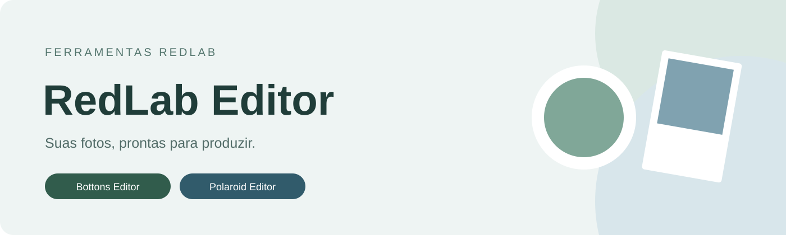
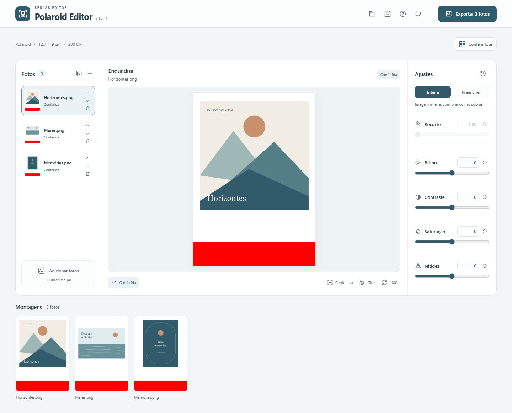

Três ferramentas para preparar imagens para impressão. Escolha a que atende ao seu trabalho; cada uma tem instalação e atualizações próprias.

| Ferramenta | Para que serve | Windows 10 e 11 · 64 bits |
| --- | --- | --- |
| **Bottons Editor** | Modelos por imagem e montagem de folhas com bottons. | [Instalador](https://github.com/redlab-coder/redlab-editor/releases/download/bottons-v1.2.0/BottonsEditor-Setup-1.2.0.exe) · [Portátil](https://github.com/redlab-coder/redlab-editor/releases/download/bottons-v1.2.0/BottonsEditor-Portable.exe) |
| **Polaroid Editor** | Enquadramento, conferência e montagem de polaroids. | [Instalador](https://github.com/redlab-coder/redlab-editor/releases/download/polaroid-v1.2.0/PolaroidEditor-Setup-1.2.0.exe) · [Portátil](https://github.com/redlab-coder/redlab-editor/releases/download/polaroid-v1.2.0/PolaroidEditor-Portable.exe) |
| **Medidas Editor** | Fotos em medidas personalizadas na folha comercial compatível. | [Instalador](https://github.com/redlab-coder/redlab-editor/releases/download/medidas-v1.1.0/MedidasEditor-Setup-1.1.0.exe) · [Portátil](https://github.com/redlab-coder/redlab-editor/releases/download/medidas-v1.1.0/MedidasEditor-Portable.exe) |

A edição funciona localmente, sem conta. Os originais são preservados e as fotos não são enviadas à nuvem. O instalador é a opção recomendada para receber atualizações; a edição portátil funciona sem instalação e é atualizada manualmente.

## Bottons Editor

Escolha Quadrado ou Redondo G, M e P **por foto**. Modelos diferentes podem dividir uma folha quando houver encaixe seguro, preservando medidas e sangria. Salve o trabalho em `.bottons` ou exporte as folhas em JPG a 300 dpi, reunidas em ZIP quando necessário. O fluxo continua sem conferência de fotos.

[Conhecer a ferramenta](apps/bottons-editor/README.md) · [Guia de uso](apps/bottons-editor/docs/usage.md) · [Gabaritos](apps/bottons-editor/docs/templates.md)

## Polaroid Editor

Edite e confira em pé; exporte na orientação horizontal de impressão. Foto de 8 × 8 cm em folha de 12,7 × 9 cm a 300 dpi, com faixa de corte preservada. Ajuste o enquadramento, use F para conferir e salve o lote em `.polaroid` para continuar depois.

[Conhecer a ferramenta](apps/polaroid-editor/README.md) · [Guia de uso](apps/polaroid-editor/docs/usage.md) · [Impressão](apps/polaroid-editor/docs/printing.md)

## Medidas Editor

Informe as medidas em centímetros e ajuste o recorte. A ferramenta escolhe a menor folha comercial compatível e preserva a área da fotografia, com branco nas sobras. Inclui 27 formatos, ajustes por imagem, lotes `.medidas` e JPEG a 300 dpi.

**Exemplo:** foto de 30 × 36 cm → folha comercial 30×40 → arquivo de 30,5 × 40 cm. A validação física de escala e cor na Noritsu permanece pendente.

[Conhecer a ferramenta](apps/medidas-editor/README.md) · [Guia de uso](apps/medidas-editor/docs/usage.md) · [Medidas e cor](apps/medidas-editor/docs/printing.md)

## Instalação e atualizações

Execute o instalador da ferramenta desejada. A instalação é por usuário, sem administrador. O aplicativo abre no navegador padrão e fica disponível pela bandeja do Windows.

A versão instalada verifica atualizações ao iniciar e a cada 30 minutos. Quando o download estiver pronto, **Atualizar e reiniciar** guarda uma cópia local do lote, instala e reabre a ferramenta com o trabalho recuperado. A cópia permanece até a confirmação da recuperação. [Veja como funciona](docs/updates.md).

**Encerrar** fecha diretamente. Salve o lote antes de encerrar para continuar em outra sessão. Nas versões anteriores, salve ou exporte o trabalho antes desta primeira atualização; a recuperação pelo novo botão passa a valer nas versões atuais.

Os repositórios de [Moldura](https://github.com/redlab-coder/moldura) e [Polaroid Editor](https://github.com/redlab-coder/polaroid-editor) preservam o histórico e as versões de transição. O desenvolvimento e os downloads atuais estão reunidos aqui.

## Projeto

[Alterações](CHANGELOG.md) · [Desenvolvimento](docs/development.md) · [Validação](docs/validation.md) · [Publicação](docs/maintenance.md) · [Contribuir](CONTRIBUTING.md) · [Relatar problema](https://github.com/redlab-coder/redlab-editor/issues/new/choose)
