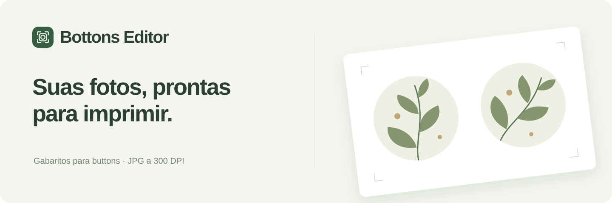
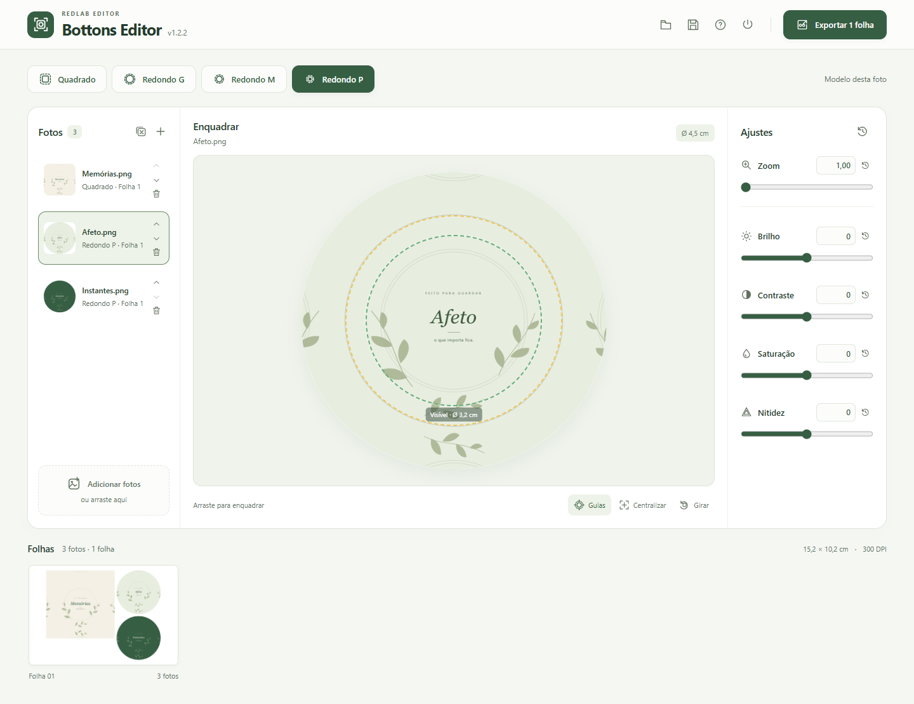
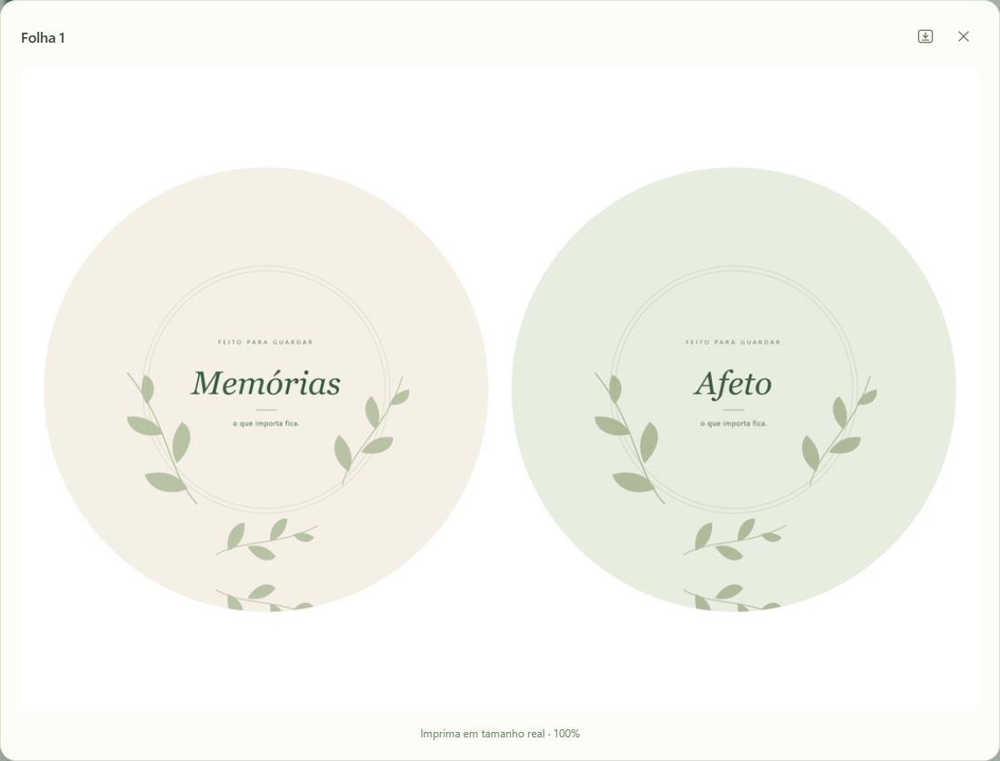

 Windows 10 e 11 · 64 bits · Instalação sem administrador

<a href="https://github.com/redlab-coder/redlab-editor/releases/tag/bottons-v1.2.0">Versão 1.2.0 e edição portátil</a> · <a href="docs/usage.md">Guia de uso</a> · <a href="../../docs/updates.md">Atualizações</a>

Prévia ampliada e tela estreita

[Ver interface em tela estreita](docs/images/mobile.png)

## Monte suas folhas

1. Adicione as imagens e escolha o modelo de cada uma.
2. Enquadre, ajuste e confira as folhas na galeria.
3. Exporte os JPGs ou salve o lote para continuar depois.

## O essencial

- **Escolha por foto.** Quadrado e Redondo G, M e P com modelos individuais.
- **Combine quando couber.** Folhas mistas com encaixe seguro, mantendo corte e sangria.
- **Ajuste com precisão.** Recorte, zoom e filtros graduais com controles numéricos.
- **Salve o lote.** Arquivos `.bottons` guardam originais, ordem, modelos e ajustes.
- **Exporte a 300 dpi.** Folha de 15,2 × 10,2 cm em JPG; várias folhas em ZIP.

O fluxo não tem etapa de conferência. Os gabaritos mantêm medidas, sangria espelhada e guias de impressão.

## Seu trabalho, no computador

Os originais são preservados e as imagens são processadas localmente. Salve o lote para continuar após encerrar; o encerramento é direto, sem confirmação. Imprima em **tamanho real / 100%**.

A versão instalada verifica atualizações periodicamente e oferece **Atualizar e reiniciar** quando o download estiver pronto, preservando o lote durante esse reinício. A edição portátil é atualizada manualmente.

[Guia de uso](docs/usage.md) · [Gabaritos](docs/templates.md) · [Desenvolvimento](docs/development.md) · [Histórico](CHANGELOG.md)

[← Todas as ferramentas RedLab](../../README.md)
