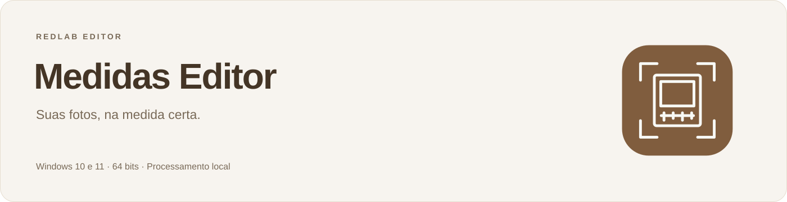
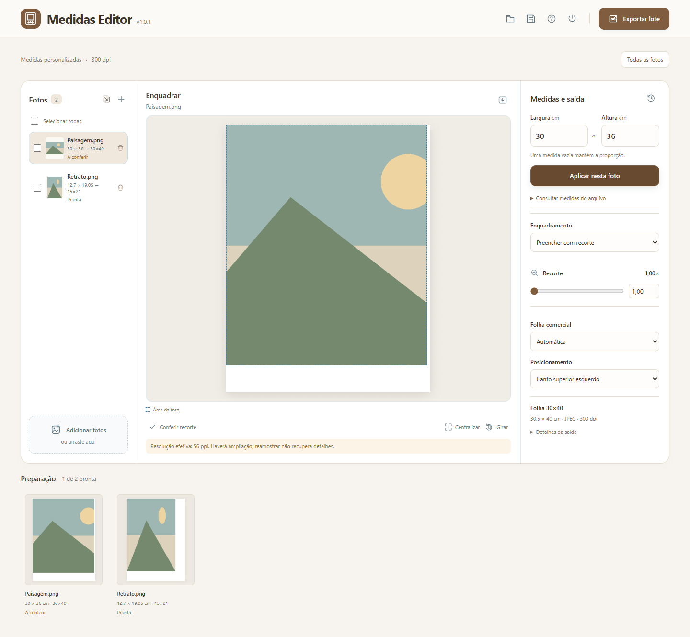
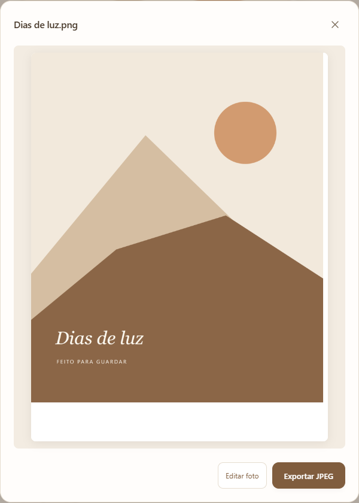

 Windows 10 e 11 · 64 bits · Instalação sem administrador

<a href="https://github.com/redlab-coder/redlab-editor/releases/tag/medidas-v1.1.0">Versão 1.1.0 e edição portátil</a> · <a href="docs/usage.md">Guia de uso</a> · <a href="../../docs/updates.md">Atualizações</a>

Prévia ampliada e tela estreita

[Ver interface em tela estreita](docs/images/mobile.png)

## Na medida certa

1. Adicione as fotos e informe largura e altura em centímetros.
2. Ajuste o enquadramento e confira os recortes pendentes.
3. Exporte JPEGs individuais ou um ZIP com os arquivos do lote.

## O essencial

- **27 folhas oficiais.** Nome comercial separado das medidas reais do arquivo.
- **Medidas personalizadas.** Vírgula ou ponto decimal e cálculo proporcional.
- **Enquadramento por imagem.** Preencher com recorte ou conter a imagem inteira.
- **Folha compatível.** Seleção automática ou manual, com posicionamento no canto.
- **Produção em lote.** Prévias, revisão, avisos de resolução e arquivos `.medidas`.

**Foto de 30 × 36 cm → folha 30×40 → arquivo de 30,5 × 40 cm.** A área da foto permanece em 30 × 36 cm; o branco fica nas sobras.

JPEG de qualidade 100, 4:4:4, 300 ppi e perfil sRGB incorporado. A entrada de cor da Noritsu e a impressão de validação de escala e cor ainda precisam ser confirmadas na REDLAB.

## Seu trabalho, no computador

Os originais são preservados e as imagens são processadas localmente. Salve o lote para continuar após encerrar; o encerramento é direto, sem confirmação. Imprima em **tamanho real / 100%**.

A versão instalada verifica atualizações periodicamente e oferece **Atualizar e reiniciar** quando o download estiver pronto, preservando o lote durante esse reinício. A edição portátil é atualizada manualmente.

[Guia de uso](docs/usage.md) · [Impressão](docs/printing.md) · [Desenvolvimento](docs/development.md) · [Histórico](CHANGELOG.md)

[← Todas as ferramentas RedLab](../../README.md)
