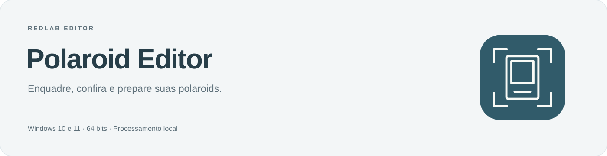
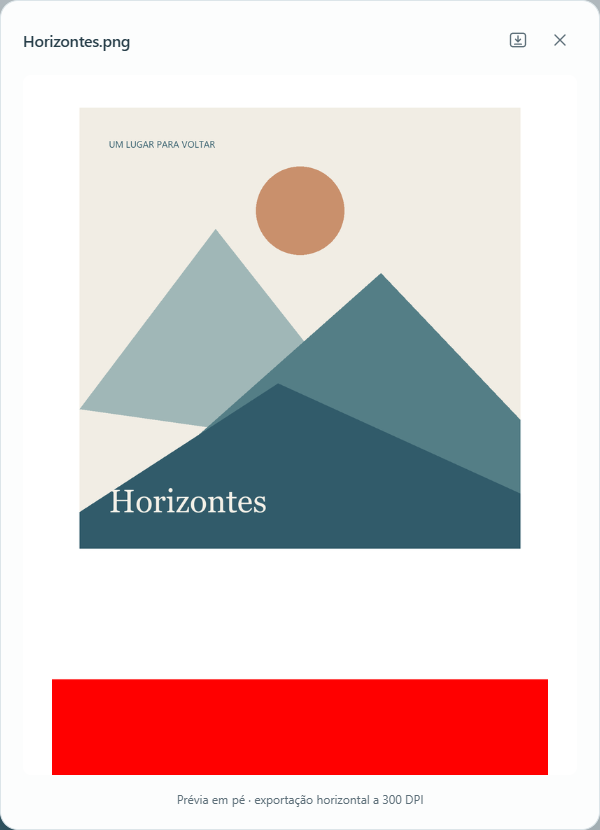

 Windows 10 e 11 · 64 bits · Instalação sem administrador

<a href="https://github.com/redlab-coder/redlab-editor/releases/tag/polaroid-v1.2.1">Versão 1.2.1 e edição portátil</a> · <a href="docs/usage.md">Guia de uso</a> · <a href="../../docs/updates.md">Atualizações</a>

Prévia ampliada e tela estreita

[Ver interface em tela estreita](docs/images/mobile.png)

## Da foto à polaroid

1. Adicione as imagens pelo botão ou arrastando para a biblioteca e o editor.
2. Ajuste o enquadramento e confira as orientações em pé.
3. Exporte as montagens ou salve o lote para continuar depois.

## O essencial

- **Medidas definidas.** Foto de 8 × 8 cm em folha de 12,7 × 9 cm a 300 dpi.
- **Prévia em pé.** Confira com o botão ou com F; a exportação mantém o giro de impressão.
- **Encaixe simples.** Imagem inteira com branco ou recorte escolhido por você.
- **Ajustes na foto.** Filtros graduais preservam o preenchimento branco.
- **Continuidade.** Lotes `.polaroid`, conferência em grade e download individual.

A faixa vermelha faz parte do corte. A exportação mantém o topo da foto à esquerda e a faixa à direita. A orientação sugerida precisa de conferência, especialmente em desenhos e colagens.

## Seu trabalho, no computador

Os originais são preservados e as imagens são processadas localmente. Salve o lote para continuar após encerrar; o encerramento é direto, sem confirmação. Imprima em **tamanho real / 100%**.

A versão instalada verifica atualizações periodicamente e oferece **Atualizar e reiniciar** quando o download estiver pronto, preservando o lote durante esse reinício. A edição portátil é atualizada manualmente.

[Guia de uso](docs/usage.md) · [Impressão](docs/printing.md) · [Desenvolvimento](docs/development.md) · [Histórico](CHANGELOG.md)

[← Todas as ferramentas RedLab](../../README.md)
